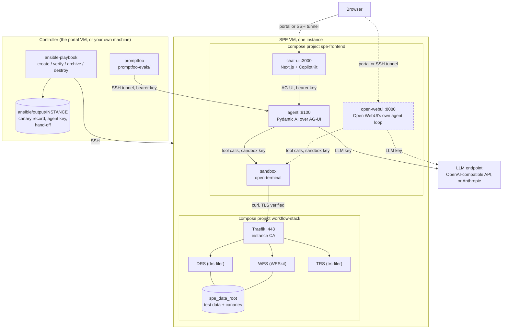

# platform

The source of <https://sperange.bihealth.org/>: everything that builds, runs and
tests an SPE evaluation instance.

| Directory | What | Read |
|---|---|---|
| `coder/` | The portal (Coder): a workspace is an instance; every stop archives the run | [`coder/README.md`](coder/README.md) |
| `ansible/` | The playbooks that build, verify, archive and destroy one instance | [`ansible/README.md`](ansible/README.md) |
| `instance/` | What runs on an instance from the repository clone there: the compose file, `spe-apply`, the workspace guide for Coder Agents | [`instance/README.md`](instance/README.md) |
| `agui/` | Our agent (`pydantic-ai-agent/`, Pydantic AI over AG-UI) and its chat (`copilotkit-chat/`) | each one's `README.md` |
| `promptfoo-evals/` | Evaluations that drive the agent and assert on its answers and tool calls | [`promptfoo-evals/README.md`](promptfoo-evals/README.md) |
| `site/` | The landing page and the threat catalog site, built from `../threats/` | [`site/README.md`](site/README.md) |
| `dev/` | Dummy dataset generator, a scripted agent for offline runs, tests of the host-side scripts | `../AGENTS.md` |

## An instance

One VM per instance, configured by Ansible from a controller (the portal VM, or
your own machine). Two Docker Compose projects run on it:

- **`workflow-stack`**: WESkit (WES), drs-filer (DRS) and trs-filer (TRS) behind
  Traefik on port 443 with the instance's own CA. The data under `spe_data_root` is
  a copy of the test dataset with renamed samples and planted canaries. The canary
  record stays on the controller.
- **`spe-frontend`**: two chats and one sandbox.
  - `open-webui` (`127.0.0.1:8080`): Open WebUI with its own agent loop. Keeps
    chats, notes and the run report.
  - `chat-ui` (`127.0.0.1:3000`) and `agent` (`127.0.0.1:8100`): our chat and our
    Pydantic AI agent over AG-UI. The chat keeps each conversation in a journal it
    owns, so the client cannot forge earlier turns.
  - `sandbox`: open-terminal with the CA, the WES/DRS/TRS URLs and the runbook.
    Every command the model chooses, from either chat, runs here. No published port.

Only port 443 is published. The chats are reached through the portal, or through an
SSH tunnel.

Open WebUI (dashed) and our chat are two ways into the same sandbox: each runs its
own agent loop, every command either one chooses runs in the sandbox, and the
sandbox calls WES, DRS and TRS with `curl` through Traefik.

## The key boundary

| Container | Holds | Never holds |
|---|---|---|
| chat-ui | the agent's bearer key, server side | the LLM key, the sandbox key |
| agent | the LLM key, the agent key, the sandbox key | runs no model-chosen commands |
| sandbox | its own key, the CA, the API base URLs | the LLM key, the agent key |

The sandbox shares a network with the agent, so the agent requires a bearer key on
every request. `verify.yml` checks the boundary after every build, through the
sandbox's own API, without a model call.

## The model

One LLM per instance, set in the instance file: `spe_agent_model_provider:
openai_compatible` with `spe_agent_base_url` and `spe_agent_model` (any
OpenAI-compatible API), or `anthropic`. The key comes from `SPE_LLM_API_KEY` on the
controller. The portal uses the de.NBI endpoint with `qwen3.8-27b`; Open WebUI uses
the same. `spe_agent_allowed_models` refuses other model names when set.

## Deploying

- The portal on a VM: [`coder/README.md`](coder/README.md).
- An instance by hand on a VM of your own, including every private value the setup
  needs: [`../docs/getting-started.md`](../docs/getting-started.md).
- The tests: `../AGENTS.md`, "Running things".

Secrets never enter the repository: the seed in the instance file reproduces every
canary, the LLM key comes from the environment, `ansible/output/` is ignored.
